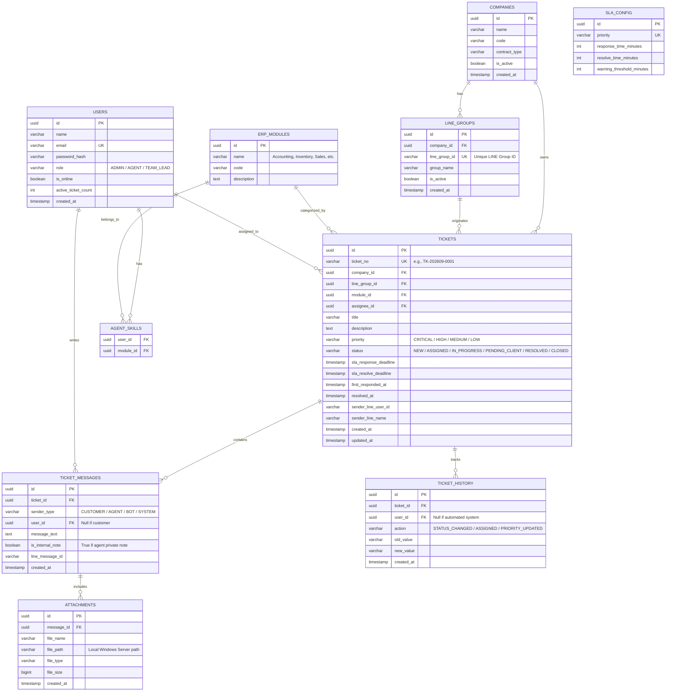

# Issue Tracking System - System Architecture & Database Specification

## ၁။ စနစ်၏ ခြုံငုံသုံးသပ်ချက် (System Overview)

ဤစနစ်သည် Customer ကုမ္ပဏီ ၂၀ ကျော် (အဓိကအားဖြင့် ERP စနစ် သုံးစွဲသူများ) ထံမှ LINE Group များမှတစ်ဆင့် တက်လာသော Issue/Complaint များကို စနစ်တကျ လက်ခံ၊ စစ်ဆေး၊ ခြေရာခံ (Track) ပြီး အချိန်မီ ဖြေရှင်းပေးနိုင်ရန် ရည်ရွယ်၍ တည်ဆောက်ထားသော **IT Service Management / Helpdesk System** ဖြစ်ပါသည်။

---

## ၂။ အကောင်အထည်ဖော်မည့် အဆင့်ဆင့် လုပ်ငန်းစဉ် (Phased Roadmap)

```
[Phase 1 - Hybrid Approach (LINE + Webapp)]
Customer (LINE Group) 
    │  (Issue text, Screenshot, #ticket trigger)
    ▼
LINE Webhook Messaging API
    │
    ▼
Webapp Backend (Ticket Creation, Auto-assign, SLA Timer, Windows Storage)
    │
    ▼
Agent Dashboard (Webapp) ──(Reply)──► LINE Push Message ──► Customer's LINE Group

-----------------------------------------------------------------------------------

[Phase 2 - Direct Request Form / Customer Portal]
Customer (Web Browser / Mobile) ──► Direct Portal Form / Login ──► Webapp Backend
```

* **Phase 1 (Hybrid Approach):** Customer များသည် မိမိတို့ အလေ့အကျင့်ရှိပြီးဖြစ်သော LINE Group ထဲတွင်သာ `#ticket` trigger ဖြင့် issue တင်မည်။ Backend မှ Webhook ဖြင့် ဖမ်းယူ၍ Ticket ဖွင့်ပေးမည်။ Agent များသည် Webapp Dashboard မှတစ်ဆင့် ပြန်လည်ဖြေရှင်းမည်။
* **Phase 2 (Direct Portal):** Customer များ တိုက်ရိုက် Web Form / Portal သုံး၍ Login ဝင်ပြီး Issue တင်နိုင်သော စနစ်သို့ တိုးချဲ့မည်။

---

## ၃။ အသုံးပြုမည့် နည်းပညာများ (Tech Stack)

| Component | Technology | Rationale |
| :--- | :--- | :--- |
| **Frontend** | Next.js (React) + Tailwind CSS + Shadcn UI | ခေတ်မီပြီး မြန်ဆန်သော Dashboard UI ရရှိစေရန် |
| **Backend** | Node.js (NestJS / Express) | Event-driven, Webhook & Real-time ကိုင်တွယ်ရ လွယ်ကူစေရန် |
| **Database** | PostgreSQL | Ticket Lifecycle, Relational Mapping & Audit Logs များအတွက် အသင့်တော်ဆုံး |
| **Background Queue** | Redis + BullMQ | LINE Webhook queue, SLA Countdown Timer & Warning Escalation များအတွက် |
| **Real-time Engine** | Socket.io / WebSockets | Dashboard တွင် Ticket အသစ်တက်လာပါက Refresh လုပ်စရာမလိုဘဲ အချိန်နှင့်တပြေးညီ ပေါ်လာစေရန် |
| **File Storage** | Local Windows Server Storage | LINE မှ Error Screenshot/Files များကို Download ဆွဲ၍ ဒေသတွင်း Hard Disk တွင် သိမ်းဆည်းရန် |

---

## ၄။ Database Schema (ERD & PostgreSQL DDL)

### ၄.၁ Mermaid Entity Relationship Diagram



---

### ၄.၂ PostgreSQL DDL Script

```sql
-- 1. Companies Table
CREATE TABLE companies (
    id UUID PRIMARY KEY DEFAULT gen_random_uuid(),
    name VARCHAR(255) NOT NULL,
    code VARCHAR(50) UNIQUE NOT NULL, -- e.g., 'ABC', 'XYZ'
    contract_type VARCHAR(50) DEFAULT 'Standard',
    is_active BOOLEAN DEFAULT TRUE,
    created_at TIMESTAMP WITH TIME ZONE DEFAULT CURRENT_TIMESTAMP,
    updated_at TIMESTAMP WITH TIME ZONE DEFAULT CURRENT_TIMESTAMP
);

-- 2. LINE Groups Mapping Table
CREATE TABLE line_groups (
    id UUID PRIMARY KEY DEFAULT gen_random_uuid(),
    company_id UUID NOT NULL REFERENCES companies(id) ON DELETE CASCADE,
    line_group_id VARCHAR(100) UNIQUE NOT NULL, -- LINE Webhook groupId (c-xxxxxxxx)
    group_name VARCHAR(255),
    is_active BOOLEAN DEFAULT TRUE,
    created_at TIMESTAMP WITH TIME ZONE DEFAULT CURRENT_TIMESTAMP
);
CREATE INDEX idx_line_groups_group_id ON line_groups(line_group_id);

-- 3. Users Table (IT Support Engineers & Admins)
CREATE TABLE users (
    id UUID PRIMARY KEY DEFAULT gen_random_uuid(),
    name VARCHAR(100) NOT NULL,
    email VARCHAR(150) UNIQUE NOT NULL,
    password_hash VARCHAR(255) NOT NULL,
    role VARCHAR(30) DEFAULT 'AGENT', -- 'ADMIN', 'TEAM_LEAD', 'AGENT'
    is_online BOOLEAN DEFAULT FALSE,
    active_ticket_count INT DEFAULT 0,
    created_at TIMESTAMP WITH TIME ZONE DEFAULT CURRENT_TIMESTAMP
);

-- 4. ERP Modules Table
CREATE TABLE erp_modules (
    id UUID PRIMARY KEY DEFAULT gen_random_uuid(),
    name VARCHAR(100) UNIQUE NOT NULL, -- 'Accounting', 'Inventory', 'Sales', 'HR/Payroll', 'POS'
    code VARCHAR(30) UNIQUE NOT NULL,
    description TEXT
);

-- 5. Agent Skills Table (Auto-assignment mapping)
CREATE TABLE agent_skills (
    user_id UUID REFERENCES users(id) ON DELETE CASCADE,
    module_id UUID REFERENCES erp_modules(id) ON DELETE CASCADE,
    PRIMARY KEY (user_id, module_id)
);

-- 6. Tickets Table
CREATE TYPE ticket_priority AS ENUM ('CRITICAL', 'HIGH', 'MEDIUM', 'LOW');
CREATE TYPE ticket_status AS ENUM ('NEW', 'ASSIGNED', 'IN_PROGRESS', 'PENDING_CLIENT', 'RESOLVED', 'CLOSED');

CREATE TABLE tickets (
    id UUID PRIMARY KEY DEFAULT gen_random_uuid(),
    ticket_no VARCHAR(50) UNIQUE NOT NULL, -- e.g., TK-202609-0001
    company_id UUID NOT NULL REFERENCES companies(id),
    line_group_id UUID REFERENCES line_groups(id),
    module_id UUID REFERENCES erp_modules(id),
    assignee_id UUID REFERENCES users(id),
    title VARCHAR(255) NOT NULL,
    description TEXT,
    priority ticket_priority DEFAULT 'MEDIUM',
    status ticket_status DEFAULT 'NEW',
    sla_response_deadline TIMESTAMP WITH TIME ZONE,
    sla_resolve_deadline TIMESTAMP WITH TIME ZONE,
    first_responded_at TIMESTAMP WITH TIME ZONE,
    resolved_at TIMESTAMP WITH TIME ZONE,
    closed_at TIMESTAMP WITH TIME ZONE,
    sender_line_user_id VARCHAR(100),
    sender_line_name VARCHAR(150),
    created_at TIMESTAMP WITH TIME ZONE DEFAULT CURRENT_TIMESTAMP,
    updated_at TIMESTAMP WITH TIME ZONE DEFAULT CURRENT_TIMESTAMP
);
CREATE INDEX idx_tickets_status_priority ON tickets(status, priority);
CREATE INDEX idx_tickets_company ON tickets(company_id);
CREATE INDEX idx_tickets_assignee ON tickets(assignee_id);

-- 7. Ticket Messages Table
CREATE TYPE sender_role AS ENUM ('CUSTOMER', 'AGENT', 'BOT', 'SYSTEM');

CREATE TABLE ticket_messages (
    id UUID PRIMARY KEY DEFAULT gen_random_uuid(),
    ticket_id UUID NOT NULL REFERENCES tickets(id) ON DELETE CASCADE,
    sender_type sender_role NOT NULL,
    user_id UUID REFERENCES users(id),
    message_text TEXT NOT NULL,
    is_internal_note BOOLEAN DEFAULT FALSE,
    line_message_id VARCHAR(100),
    created_at TIMESTAMP WITH TIME ZONE DEFAULT CURRENT_TIMESTAMP
);
CREATE INDEX idx_ticket_messages_ticket ON ticket_messages(ticket_id);

-- 8. Attachments Table (Windows Local Storage Files)
CREATE TABLE attachments (
    id UUID PRIMARY KEY DEFAULT gen_random_uuid(),
    message_id UUID NOT NULL REFERENCES ticket_messages(id) ON DELETE CASCADE,
    file_name VARCHAR(255) NOT NULL,
    file_path VARCHAR(500) NOT NULL, -- e.g., 'D:/Issue Tracking System/storage/uploads/2026/09/uuid.jpg'
    file_type VARCHAR(100),
    file_size BIGINT,
    created_at TIMESTAMP WITH TIME ZONE DEFAULT CURRENT_TIMESTAMP
);

-- 9. Ticket History / Audit Trail Table
CREATE TABLE ticket_history (
    id UUID PRIMARY KEY DEFAULT gen_random_uuid(),
    ticket_id UUID NOT NULL REFERENCES tickets(id) ON DELETE CASCADE,
    user_id UUID REFERENCES users(id),
    action VARCHAR(50) NOT NULL, -- 'STATUS_CHANGED', 'ASSIGNED', 'PRIORITY_UPDATED'
    old_value VARCHAR(255),
    new_value VARCHAR(255),
    created_at TIMESTAMP WITH TIME ZONE DEFAULT CURRENT_TIMESTAMP
);

-- 10. SLA Configuration Table
CREATE TABLE sla_config (
    id UUID PRIMARY KEY DEFAULT gen_random_uuid(),
    priority ticket_priority UNIQUE NOT NULL,
    response_time_minutes INT NOT NULL,
    resolve_time_minutes INT NOT NULL,
    warning_threshold_minutes INT NOT NULL
);

INSERT INTO sla_config (priority, response_time_minutes, resolve_time_minutes, warning_threshold_minutes) VALUES
('CRITICAL', 15, 120, 10),
('HIGH', 30, 240, 20),
('MEDIUM', 60, 480, 45),
('LOW', 120, 1440, 90);
```

---

## ၅။ LINE Group Bot Architecture & Group Chat Flow

Group Chat အတွင်း သာမန် စကားပြောဆိုမှုများနှင့် Issue တင်မှုများကို ခွဲခြားနိုင်ရန် အောက်ပါ Workflow အတိုင်း လုပ်ဆောင်မည်-

1. **Company & Group Binding (ပထမဆုံး ချိတ်ဆက်ခြင်း):**
   * Bot ကို Customer LINE Group ထဲသို့ Invite လုပ်ပြီးနောက် IT Admin မှ အောက်ပါ command ဖြင့် ကုမ္ပဏီနှင့် Group ID ကို ချိတ်ဆက်ပေးရမည်-
     `@bot bind <COMPANY_CODE>` (ဥပမာ- `@bot bind KBZ`)
   * Backend မှ LINE Webhook payload ရှိ `groupId` ကို `line_groups` table တွင် မှတ်သားပေးမည်။
2. **Issue Triggering:**
   * Customer ဘက်မှ `#ticket` ဟု စတင်၍ တင်သော စာများကိုသာ Bot မှ Ticket အဖြစ် အသိအမှတ်ပြုမည်။
   * ဥပမာ- `#ticket [Inventory] Closing stock error ဖြစ်နေပါသည်`
3. **Follow-up Messages & Attachments:**
   * လက်ရှိ ပွင့်နေဆဲ Ticket ရှိသော Group ဖြစ်ပါက Customer ပို့သမျှ စာများနှင့် Screenshots များကို ထို Ticket ၏ `ticket_messages` နှင့် `attachments` သို့ auto-append ပြုလုပ်ပေးမည်။
4. **Agent Reply Back to LINE:**
   * Engineer များက Webapp Dashboard ပေါ်မှ စာပြန်သောအခါ LINE Messaging API (Push Message) သုံး၍ သက်ဆိုင်ရာ LINE Group ဆီသို့ Bot အနေဖြင့် အလိုအလျောက် ပြန်ပို့ပေးမည်။

---

## ၆။ Windows Server Local Storage & Attachments Handling

LINE Messaging API မှ Screenshot/Image URL များသည် ခေတ္တသာ ခံသောကြောင့် ချက်ချင်း Download ရယူ၍ Windows Server ပေါ်တွင် အောက်ပါအတိုင်း သိမ်းဆည်းမည်-

```
D:\Issue Tracking System\storage\
└── uploads\
    └── {YYYY}\
        └── {MM}\
            └── {ticket_id}\
                └── {uuid}.jpg
```

* **Download Pipeline:** LINE Webhook မှ `image` message ရောက်သည်နှင့် LINE Content API (`https://api-data.line.me/v2/bot/message/{messageId}/content`) သို့ Request ခေါ်၍ Local Storage သို့ Stream ဖြင့် သိမ်းဆည်းခြင်း။
* **File Serving:** Backend (Node.js/NestJS) ၏ Static Asset Serving သို့မဟုတ် IIS / Reverse Proxy ဖြင့် Dashboard ပေါ်တွင် ပုံများကို ပြသခြင်း။

---

## ၇။ Auto-Assignment & SLA Warning (Redis + BullMQ)

* **Auto-Assignment Logic:**
  1. Ticket တွင် ပါလာသော ERP Module ကို ကျွမ်းကျင်သော (`agent_skills`) အင်ဂျင်နီယာများကို စစ်ဆေးသည်။
  2. လက်ရှိ `is_online = true` ဖြစ်ပြီး `active_ticket_count` အနည်းဆုံး အင်ဂျင်နီယာထံ အလိုအလျောက် တာဝန်ချပေးသည်။
  3. အကယ်၍ Online ရှိသူ မရှိပါက `Team Lead` ထံသို့ Default Fallback ချပေးသည်။
* **SLA Warning & Escalation:**
  * Ticket စတင်ဖွင့်သည်နှင့် BullMQ တွင် Delayed Job အဖြစ် Countdown စတင်သည်။
  * Response Time မပြည့်မီ Warning Threshold ရောက်ပါက Dashboard တွင် **Red Warning Alert** ပြခြင်းနှင့် IT Team အတွင်းရေး LINE Group သို့ သတိပေးစာ ပို့ခြင်း (Escalation) ပြုလုပ်သည်။

---

## ၈။ Next.js Frontend Dashboard (UI Modules)

1. **Kanban & List View:**
   * Filter များ: Company Name, ERP Module, Priority, Assignee, Status, Date Range.
   * Column များ: `New` -> `Assigned` -> `In Progress` -> `Pending Client` -> `Resolved`.
   * SLA Countdown Badge (စိမ်း/ဝါ/နီ အရောင်ဖြင့် သတိပေးခြင်း)။
2. **Ticket Detail & Chat Workspace:**
   * ဘယ်ဘက်: Customer LINE Message & Error Screenshots.
   * အလယ်: Agent Reply Box (LINE Group သို့ တိုက်ရိုက် စာပို့ရန်) + Internal Private Note (အဖွဲ့တွင်း မှတ်ချက်)။
   * ညာဘက်: Company Info, Module, Assignee, Priority, Audit Trail History.
3. **Analytics & Reports:**
   * ကုမ္ပဏီအလိုက် အဖြစ်များသော ERP Module များ၊ Average Resolution Time နှင့် SLA Breach စာရင်းဇယားများ။
